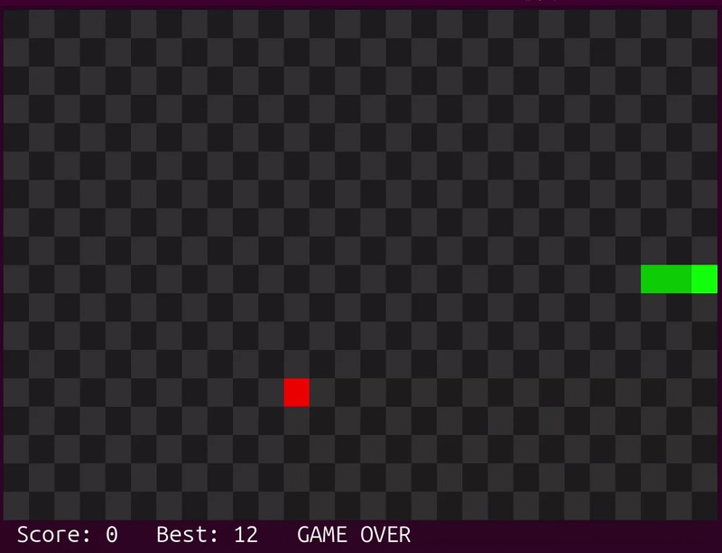

# 🐍 termsnake

Snake for your terminal. Colored blocks, smooth controls, no libraries, one C++ file.



## Play

```bash
git clone https://github.com/YOURNAME/termsnake.git
cd termsnake
make run
```

You need a C++17 compiler and `make`:

- **Ubuntu/Debian:** `sudo apt install build-essential`
- **macOS:** `xcode-select --install`
- **Windows:** use [WSL](https://learn.microsoft.com/windows/wsl/install) and follow the Ubuntu steps

Your terminal needs 256 colors and at least 56×20 characters.

## Controls

| Key | Action |
|---|---|
| Arrows / WASD | Move |
| Space | Pause |
| Enter | Play again |
| Q / Esc | Quit |

## Install

```bash
make install     # then run it anywhere with: termsnake
make uninstall
```

Make sure `~/.local/bin` is on your `PATH`.

## Features

- The game speeds up as you score
- Quick key presses are queued, so tight turns work
- Best score is saved in `~/.termsnake_highscore`
- Restores your terminal cleanly on exit, even on Ctrl+C

## How it works

Each square is two spaces with a colored background (ANSI escape codes). Keys are read with `termios` and `poll`, and the whole game is in [`src/main.cpp`](src/main.cpp).

## License

MIT
